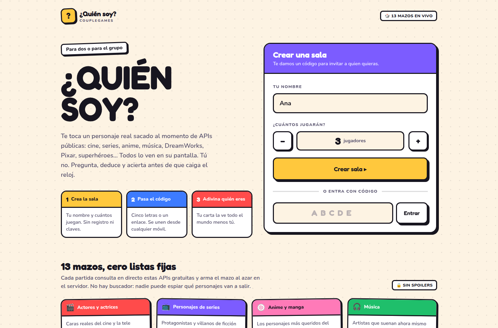
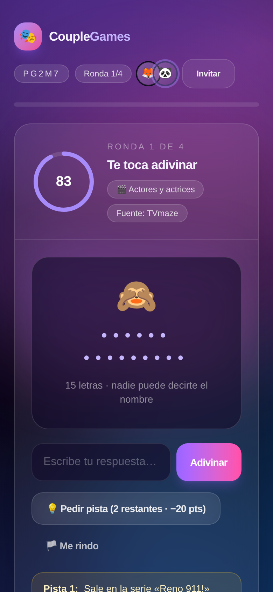
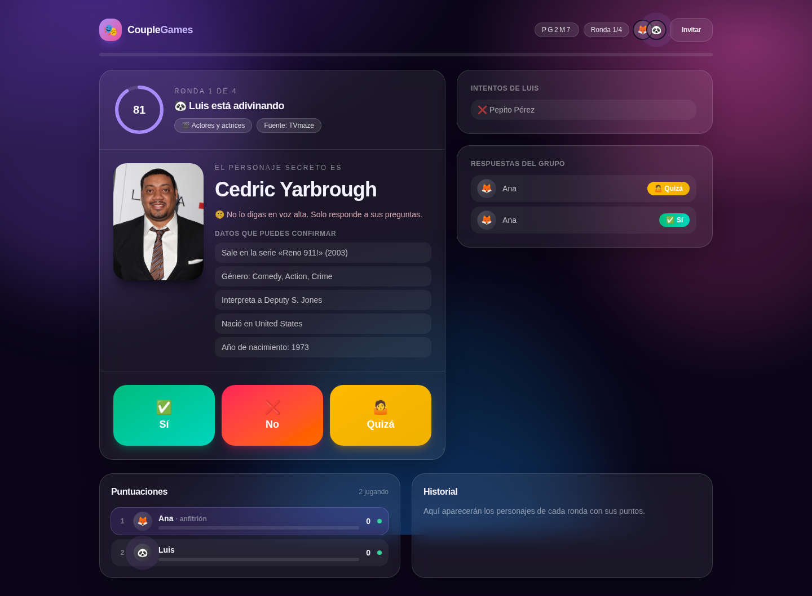

# CoupleGames · ¿Quién soy?

Juego cooperativo de adivinar personajes para **parejas y grupos pequeños**. Cada
ronda reparte un personaje real traído **en vivo desde APIs públicas gratuitas**
(cine, series, anime, música, DreamWorks, Pixar, Disney, superhéroes, Harry
Potter, libros, Pokémon…): no hay lista fija ni buscador, y el jugador que
adivina nunca puede ver su propia carta.



## Cómo se juega

1. **Creas la sala** con tu nombre y cuántos van a jugar. No hay registro, ni
   claves, ni API keys.
2. **Compartes el enlace** (o el código de 5 letras). El resto entra desde
   cualquier móvil y aparece en el lobby al instante.
3. **Por turnos, alguien adivina**: su personaje se muestra en las pantallas del
   resto y en la suya solo aparecen los huecos del nombre.
4. Quien adivina **pregunta en voz alta** y el grupo responde con los botones
   **Sí / No / Quizá**. Puede gastar hasta **3 pistas** (−20 puntos cada una)
   antes de arriesgar un nombre.
5. Acertar rápido da más puntos; el resto del grupo también suma por ayudar.
   Al terminar hay **podio, historial** y **revancha** con personajes nuevos.

| Quien adivina (móvil) | El resto del grupo |
| --- | --- |
|  |  |

Más capturas en [`docs/screenshots`](docs/screenshots).

## Reglas de secreto (anti-spoiler)

La sorpresa se protege en el **servidor**, no en la interfaz:

- El mazo de la partida vive solo en memoria del servidor: **no existe ningún
  endpoint que lo devuelva**, ni completo ni parcial.
- El estado que recibe quien adivina se serializa aparte
  (`lib/view.ts`): nunca incluye el nombre ni la imagen de su personaje, solo la
  máscara (`••••• •••••`), la categoría y las pistas que ya pagó.
- Las respuestas se validan en el servidor (`lib/game.ts`): el cliente solo
  recibe `correct: true/false`, nunca una pista de cuánto se acercó.
- Las pistas se revelan de una en una y se **censura** cualquier aparición del
  nombre del personaje dentro del texto (`redact()` en `lib/text.ts`).
- No hay buscador, listado ni autocompletado de personajes en ninguna pantalla.

## Fuentes de personajes (todas gratuitas y sin API key)

| Categoría | API | Qué aporta |
| --- | --- | --- |
| Actores y actrices | [TVmaze](https://www.tvmaze.com/api) | Personas reales del reparto de series populares |
| Personajes de series | [TVmaze](https://www.tvmaze.com/api) | Personajes de ficción con foto |
| Anime y manga | [AniList](https://anilist.gitbook.io/anilist-apiv2-docs) | Los personajes más votados, con su serie y géneros |
| Música | [Deezer](https://developers.deezer.com/api) | Artistas del top por género, con su canción más escuchada |
| DreamWorks | [DreamWorks Wiki](https://dreamworks.fandom.com) | Shrek, Kung Fu Panda, Madagascar, Dragons… vía la API de MediaWiki |
| Pixar | [Pixar Wiki](https://pixar.fandom.com) | Toy Story, Del revés, Cars… vía la API de MediaWiki |
| Superhéroes | [Superhero API](https://akabab.github.io/superhero-api/) | Marvel, DC y compañía, con estadísticas y afiliaciones |
| Harry Potter | [HP-API](https://hp-api.onrender.com) | Casa, varita, patronus y quién le pone cara |
| Libros | [Open Library](https://openlibrary.org/developers/api) | Autores y autoras, con portada y títulos |
| Pokémon | [PokéAPI](https://pokeapi.co) | Nombre en español, tipos y texto de la Pokédex |
| Rick and Morty | [Rick and Morty API](https://rickandmortyapi.com) | Personajes del multiverso |
| Disney | [Disney API](https://disneyapi.dev) | Personajes con sus películas |
| Star Wars | [SWAPI](https://swapi.info) | Personajes de la saga y su planeta natal |

Cada partida pide páginas, géneros y offsets **aleatorios**, mezcla las
categorías en round-robin y descarta repetidos, así que dos partidas seguidas
no comparten personajes. Si una API falla, el resto sigue alimentando el mazo.

Los dos mazos de animación leen la API estándar de MediaWiki que expone cada
wiki de Fandom: se sortea una categoría de personajes, se quedan los artículos
más largos (la señal más fiable de que el personaje es conocido) y las pistas se
arman con las categorías de cada ficha, comprobando contra el propio wiki qué
categorías son películas de verdad y cuáles son solo etiquetas.

## Puntuación

- Acertar: `120 − segundos usados − 20 × pistas`, con un mínimo de 25 puntos.
- El resto del grupo gana 15 puntos por ronda acertada (es cooperativo).
- Rendirse o quedarse sin tiempo: 0 puntos, y se revela el personaje.
- El historial guarda todas las rondas de todas las partidas de la sala.

## Diseño

Estética de juego de mesa impreso, no de panel de control: fondo de papel con
trama de puntos, cartas blancas con borde de tinta de 3 px y sombra dura sin
desenfoque, botones que se hunden al pulsarlos, colores planos y saturados
(nada de degradados ni cristal esmerilado) y tipografía Fredoka para los
titulares. El personaje oculto se presenta como una carta boca abajo con una
casilla vacía por letra, y las respuestas del grupo son tres teclas grandes
pensadas para el pulgar.

## Stack

- **Next.js 16** (App Router, Route Handlers, Turbopack) + **React 19** + TypeScript
- **Tailwind CSS v4** con tokens propios (`ink`, `paper`, `sun`, `tomato`…), utilidades `sheet` / `press` y animaciones de cartón
- Estado de sesión **en memoria del servidor** (`lib/store.ts`) y sincronización
  por *polling* cada 1,2 s — sin base de datos ni servicios externos

```
app/
  page.tsx                  Portada: crear sala / unirse por código
  s/[code]/page.tsx         Sala de juego
  api/sessions/route.ts     POST crea la sala
  api/sessions/[code]/      GET estado (ya filtrado) · POST acciones
components/                 Landing, Lobby, Play, Reveal, Finished, UI
lib/
  game.ts                   Reglas, turnos, puntuación
  view.ts                   Serializa el estado según quién lo pide
  store.ts                  Sesiones en memoria
  text.ts                   Normalización, tolerancia a erratas, censura
  providers/                Un módulo por API pública
```

## Ejecutar en local

```bash
npm install
npm run dev          # http://localhost:3000
```

Para probar con varios jugadores en el mismo equipo, abre la sala en una
ventana normal y en otra de incógnito (la identidad se guarda por sala en
`localStorage`).

```bash
npm run build && npm start   # producción
npm run lint                 # eslint
npm run typecheck            # tsc --noEmit
```

## Despliegue

Las sesiones viven en memoria del proceso, así que la app necesita ejecutarse
como **un único servidor Node** (`npm run build && npm start`) en algo tipo
Railway, Render, Fly.io o un VPS. En un entorno *serverless* con varias
instancias (por ejemplo Vercel con escalado) cada petición podría caer en un
proceso distinto y perder la sala: para ese caso basta con reemplazar
`lib/store.ts` por Redis/Upstash manteniendo la misma interfaz
(`getSession`, `saveSession`, `putSession`).

Las salas inactivas se descartan automáticamente a las 6 horas.
